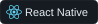
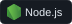

# Hi there, I'm Jaden Patel

**Software Engineer | AI Power-User**

I've designed, implemented, and deployed web and mobile applications across Web, iOS, and Android. Developing across frontend, backend, and cloud (AWS) with a focus on performance via optimized system design and aesthetic, responsive, and accessible UI designs.

- 🎓 Bachelor’s in Computer Engineering from Oklahoma State University
- 👨‍💻 2+ years of experience as a Full-stack Software Engineer
- 🎯 Focused on building scalable, cloud-native applications with clean design & architecture
- 🤖 Building with LLMs, multi-agent systems and agentic workflows

[LinkedIn](https://www.linkedin.com/in/jaden-patel/) · [Résumé](resume.pdf)

## Experience

- **Software Engineer · L3Harris — Current**
- **Cybersecurity Intern · Interstate Batteries**
- **Software Engineer Intern · Consumer Affairs**

## Skills

### Languages

### Frontend | Web & Mobile

Responsive & Accessible Design (Web, Desktop, Mobile)

### Backend & Data

WebSockets · Vector DB

### Cloud & DevOps

### AI & Engineering

RAG · LLMOps · MLOps · System Design · JWT Auth · CORS · Rate Limiting

### Design & Tools

## Contributions

<a href="https://github.com/jspace202?tab=overview#contributions">
  <picture>
    <source media="(prefers-color-scheme: dark)" srcset="https://raw.githubusercontent.com/jspace202/jspace202/output/github-snake-dark.svg?v=2">
    
  </picture>
</a>
